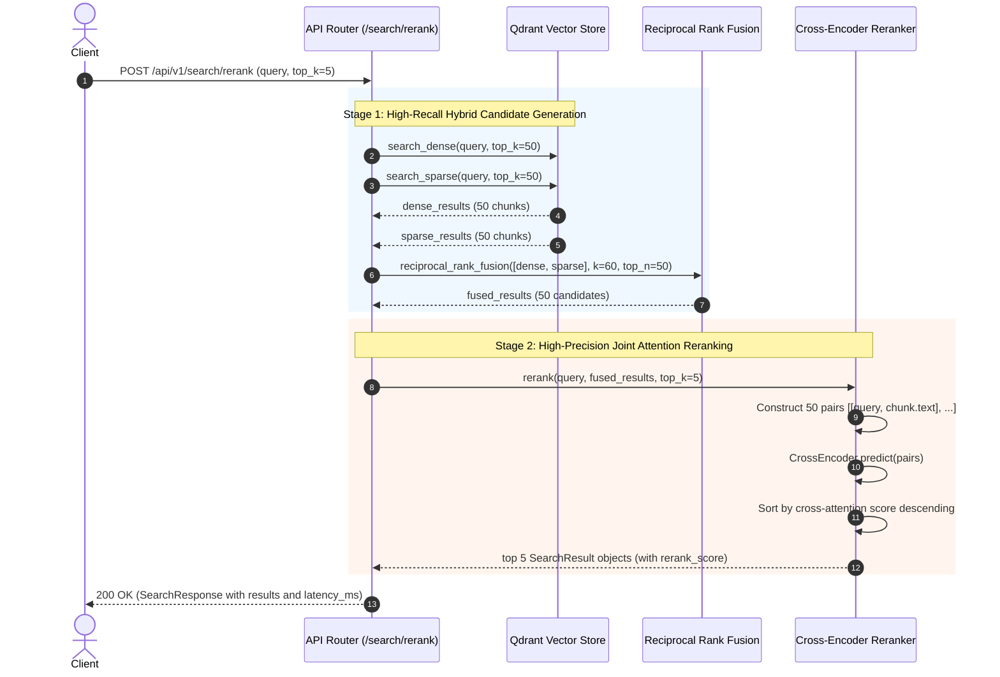

# Day 4 Learning Guide: Cross-Encoder Reranking & Retrieval Evaluation

Welcome to Day 4! Today we elevated our retrieval pipeline from a single-pass search into an industry-grade **two-stage retrieval architecture** (Fast Candidate Generation $\to$ Neural Cross-Encoder Reranking). We also constructed a comprehensive **119-question Golden Evaluation Set** with explicit unanswerable questions, and implemented an offline **IR Benchmarking Engine** to measure Recall@K, MRR, and latency.

---

## 1. Plain English Summary

Imagine you are hiring a chief financial analyst:
- **Stage 1 (Bi-Encoder / Hybrid Search)** is like an automated resume keyword scanner and broad skills filter. In a few milliseconds, it filters 100,000 applicants down to the top 50 candidates. It's fast, but it reads the job description and the resume separately, missing nuanced context.
- **Stage 2 (Cross-Encoder Reranker)** is an in-person, 1-on-1 interview between the hiring manager and each of the top 50 candidates. The manager evaluates candidate answers specifically against each interview question. It's thorough and accurate, but it takes time, so you can only do it for the top 50, not all 100,000.

By combining both stages, we get the best of both worlds:
1. **High recall** over a massive corpus in under 20 milliseconds.
2. **High precision** scoring from a cross-attention transformer that places the single best answer at rank #1.

---

## 2. First-Principles Concepts

### A. Bi-Encoder vs. Cross-Encoder: The Attention Difference

Why can't a dense vector embedding capture everything?

```
BI-ENCODER (Dense Embedding):
Query:   "What was Apple's R&D spend?"   ---> [ Transformer ] ---> Vector Q (384-d)
                                                                       |
                                                                  Cosine Sim = Q · D
                                                                       |
Passage: "Apple invested $29.9B in R&D." ---> [ Transformer ] ---> Vector D (384-d)

No token-to-token attention between Query and Passage!
```

In a **Bi-Encoder** (like `all-MiniLM-L6-v2`):
- The query and the passage are encoded completely independently.
- The transformer compresses the entire passage into a single fixed-size 384-dimensional vector.
- Relevance is estimated via cosine similarity (dot product of two vectors).
- **Limitation**: The passage vector has no idea what query will be asked when it is encoded at ingestion time. Nuances like negation ("not including discontinued operations") or syntactic role binding can get blurred during pooling.

```
CROSS-ENCODER (Joint Attention):
Input: [CLS] Query tokens [SEP] Passage tokens [EOS]
             |                 |
             +--------+--------+
                      |
             [ Transformer Layers ]  <-- Full All-to-All Cross Attention!
                      |                  Every query token attends to every passage token
             [ Classification Head ]
                      |
             Relevance Score (scalar)
```

In a **Cross-Encoder** (like `cross-encoder/ms-marco-MiniLM-L-6-v2`):
- The query and the passage are concatenated into a single input sequence.
- Every token in the query can attend directly to every token in the passage across all 6 transformer layers.
- The model observes exact word relationships, grammatical modifier bindings, and semantic constraints.
- **Cost**: You cannot pre-compute embeddings! You must run the entire transformer forward pass for every query-passage pair at query time. For $N$ documents, complexity is $O(N \cdot L^2)$.

---

### B. Two-Stage Retrieval Pipeline

To balance speed and accuracy, production search systems (Google, Bing, Amazon) use a multi-stage funnel:

```
Full Corpus (100,000+ chunks)
          |
          v
[ Stage 1: Hybrid Retrieval (Dense + BM25 + RRF) ]  <-- 10-20 ms (Scale: O(log N))
          |
          v
Top 50 Candidate Pool
          |
          v
[ Stage 2: Cross-Encoder Reranker ]                 <-- 30-50 ms (Scale: O(K), K=50)
          |
          v
Final Top 5 Chunks to LLM Context Window
```

Why 50 candidates?
- If $K=10$, we might miss relevant chunks that hybrid retrieval ranked at #12 or #15.
- If $K=200$, cross-encoder inference on CPU takes $> 1$ second, destroying user experience.
- Empirical IR research consistently finds that the "recall ceiling" typically plateaus between $K=30$ and $K=60$. 50 candidates represents the sweet spot on the Pareto curve.

---

### C. Information Retrieval (IR) Metrics: Recall@K and MRR

When evaluating search and RAG retrieval, standard accuracy is not sufficient. We use two core metrics:

#### 1. Recall@K
$$\text{Recall}@K = \frac{|\text{Relevant Chunks in Top } K|}{|\text{Total Relevant Chunks}|}$$

- **Why it matters for RAG**: An LLM cannot cite or answer from evidence it never receives. If a relevant chunk is ranked at #7 and your context window only takes top 5, your Recall@5 is 0% and your LLM will either hallucinate or abstain.
- In RAG, **Recall@K is a hard constraint**; precision matters mainly for token cost and context noise.

#### 2. Mean Reciprocal Rank (MRR)
For a set of $Q$ queries:
$$\text{MRR} = \frac{1}{|Q|} \sum_{i=1}^{|Q|} \frac{1}{\text{rank}_i}$$
where $\text{rank}_i$ is the rank position of the **first relevant document** for query $i$.

- If the first relevant document is at Rank 1: Reciprocal Rank = $1/1 = 1.0$
- If the first relevant document is at Rank 2: Reciprocal Rank = $1/2 = 0.5$
- If the first relevant document is at Rank 5: Reciprocal Rank = $1/5 = 0.2$
- If no relevant document is found: Reciprocal Rank = $0.0$

**Why MRR is crucial**:
Large Language Models exhibit a phenomenon called **"Lost in the Middle"** (Liu et al., 2023) — they pay highest attention to tokens at the very beginning and very end of their prompt context. Pushing the most relevant chunk from rank 4 to rank 1 via reranking significantly boosts downstream answer quality!

---

## 3. Step-by-Step Request Walkthrough: `POST /api/v1/search/rerank`

Let's trace what happens when a client sends:
```json
{
  "query": "What was Apple's total revenue in fiscal year 2023?",
  "top_k": 5
}
```



1. **Request validation**: FastAPI validates that `query` is non-empty and `top_k` is between 1 and 100.
2. **Dense search over-retrieval**: Embeds query with `all-MiniLM-L6-v2` and searches Qdrant's `"dense"` vector index for the top 50 chunks.
3. **Sparse search over-retrieval**: Encodes query with BM25 term IDF weights and searches Qdrant's `"sparse"` vector index for the top 50 chunks.
4. **RRF fusion**: Combines the 50 dense and 50 sparse hits using reciprocal rank scoring $1 / (60 + r)$, resolving duplicates and producing a unified 50-candidate pool.
5. **Cross-encoder prediction**: `rerank()` pairs the query with each of the 50 chunk texts. All 50 pairs are processed through `ms-marco-MiniLM-L-6-v2`.
6. **Metadata preservation**: The raw cross-encoder score is assigned to `result.score` and `result.metadata["rerank_score"]`, while the stage 1 RRF score is preserved in `result.metadata["retrieval_score"]`.
7. **Response**: Returns the top 5 highest-scoring chunks with measured latency.

---

## 4. Interview Questions & Answers

### Q1: What is the fundamental architectural difference between a bi-encoder and a cross-encoder?
**Answer**:
A **bi-encoder** encodes query and document into separate vector representations $u = f(q)$ and $v = g(d)$ independently, estimating similarity using a simple geometric dot product or cosine similarity $\langle u, v \rangle$. This allows document embeddings to be pre-computed offline and indexed in an approximate nearest neighbor (ANN) vector database like Qdrant for sub-10ms retrieval across millions of records.
A **cross-encoder** concatenates the query and document into a single joint sequence $[CLS] \circ q \circ [SEP] \circ d \circ [EOS]$ and passes it through all transformer layers together. This enables every token in the query to attend directly to every token in the document via cross-attention, capturing complex semantic dependencies, negation, and lexical matching. However, cross-encoders cannot be pre-indexed; every pair must be evaluated at inference time, making them $O(N)$ and computationally prohibitive for full-corpus search.

### Q2: Why don't we rerank the top 500 candidates instead of the top 50?
**Answer**:
Two reasons: **latency economics** and **diminishing recall returns**.
1. **Latency**: Cross-encoder inference scales linearly with candidate count. On CPU, scoring 50 pairs with `ms-marco-MiniLM-L-6-v2` takes ~35ms. Scoring 500 pairs would take ~350–500ms, which is unacceptable for an interactive RAG service SLA.
2. **Recall plateau**: In a well-tuned first-stage hybrid retrieval system (dense + BM25 with RRF), the candidate pool recall (Recall@50) is typically $>95\%$. If the relevant document is not within the top 50 candidates, expanding to top 500 rarely salvages it and instead injects distracting false positives that the reranker might mistakenly elevate.

### Q3: What is the "Lost in the Middle" problem and how does a cross-encoder help resolve it?
**Answer**:
Research by Liu et al. (Stanford, 2023) demonstrated that decoder LLMs suffer from positional bias: when relevant information is located in the middle of a long prompt context, retrieval-augmented models frequently fail to access it, performing much better when critical information is placed at the very beginning (top 1-2) or very end of the prompt.
A cross-encoder directly mitigates this by maximizing **Mean Reciprocal Rank (MRR)**. By scoring the query-document interaction with full cross-attention, it reorders the retrieved pool so that the single most directly relevant chunk is promoted to Rank 1 or Rank 2, positioning it at the optimal attention window for the generator LLM.

### Q4: Why did we choose `cross-encoder/ms-marco-MiniLM-L-6-v2` over larger models like `bge-reranker-large`?
**Answer**:
Under our strict **zero-cost, CPU-friendly production constraint**, `ms-marco-MiniLM-L-6-v2` offers the best Pareto efficiency:
- Model footprint is only ~80 MB and 22M parameters.
- It is trained on the MS MARCO passage ranking dataset (hundreds of thousands of real search queries), giving it strong domain-general relevance judgment.
- Steady-state CPU inference for a batch of 50 pairs is ~35 ms.
- In contrast, `bge-reranker-large` is 560M parameters (~1.3 GB) and takes $>1.5$ seconds on CPU per query, violating interactive latency requirements unless dedicated GPU infrastructure is provisioned.

### Q5: How do Recall@K and MRR differ, and why are both necessary to evaluate RAG retrieval?
**Answer**:
- **Recall@K** measures **coverage**: what fraction of all ground-truth relevant documents were captured within the top $K$ results? In RAG, Recall@K determines the ceiling of what the LLM could possibly know.
- **MRR (Mean Reciprocal Rank)** measures **ranking quality**: where does the *first* relevant document appear? $MRR = \frac{1}{\text{rank}_1}$.
- Both are needed because a system could achieve Recall@10 = 1.0 by placing relevant chunks at ranks 8, 9, and 10, but its MRR would be only 0.125 ($1/8$). In such a case, the LLM prompt is polluted with 7 irrelevant distractors before the true answer appears. High Recall@K ensures the answer is present; high MRR ensures it is front and center.

### Q6: Why did we include 20 unanswerable questions in our golden evaluation set?
**Answer**:
In financial intelligence, **hallucinating a metric or inventing forward guidance is far worse than admitting missing evidence**.
Standard RAG benchmarks only test whether the system can retrieve when an answer exists. However, real-world users frequently ask forward-looking speculative questions (*"What is Tesla's projected revenue for 2030?"*) or questions outside corporate disclosures (*"What is Apple's secret product roadmap?"*).
By benchmarking against explicit unanswerable queries, we can evaluate whether the retrieval scores are sufficiently low and whether downstream agent confidence scoring (Day 6) correctly triggers an **abstention** decision rather than hallucinating an answer.

### Q7: Why do cross-encoder scores sometimes come out negative or greater than 1.0?
**Answer**:
Bi-encoder cosine similarity is bounded in $[-1.0, 1.0]$ by mathematical definition. In contrast, most cross-encoders (including `ms-marco-MiniLM-L-6-v2`) output raw **logits** from an unnormalized linear classification layer trained with binary cross-entropy or margin ranking loss.
These logits are not probabilities; they are unbounded real numbers where higher numbers denote higher relative relevance. Because reranking is purely a sorting operation ($\text{argsort}$), raw logits preserve order without needing a sigmoid transformation.

### Q8: What is lazy model loading and why did we implement it for the reranker?
**Answer**:
In `app/rerank/reranker.py`, the `CrossEncoder` model is assigned to a module-level variable initialized to `None` and loaded inside `_get_model()` upon the first call.
If we loaded the model at top-level module import time:
1. Every test file or utility script that imports anything from `app` would be forced to load PyTorch and download/deserialize an 80MB model from disk, adding 2–5 seconds of startup latency.
2. Lightweight unit tests (e.g., chunker tests, config tests) would run unnecessarily slowly.
Lazy loading guarantees zero startup overhead until retrieval or reranking is actually executed.

---

## 5. Self-Check Questions

1. **True or False**: A bi-encoder computes attention between query tokens and document tokens.  
   *(Answer: False. Bi-encoders encode query and document independently; only cross-encoders compute cross-attention between their tokens.)*

2. **If a relevant chunk is at Rank 4, what is its Reciprocal Rank?**  
   *(Answer: $1/4 = 0.25$.)*

3. **Why can't we index 1,000,000 document passages directly into a cross-encoder for sub-second search?**  
   *(Answer: Cross-encoders require computing all-to-all cross-attention for each query-passage pair at query time. Evaluating 1,000,000 pairs would take hours.)*

4. **What metric would be 0 if the only relevant document is ranked at position 6 and we evaluate top 5?**  
   *(Answer: Recall@5 is 0.0. Recall@10 would be 1.0.)*

5. **Where are the original first-stage retrieval scores preserved after cross-encoder reranking in our system?**  
   *(Answer: In `result.metadata["retrieval_score"]`.)*

---

## 6. Failure Modes & Edge Cases

| Failure Mode | Root Cause | Impact | Mitigation in Engine |
|---|---|---|---|
| **Cold-Start Latency Spike** | First cross-encoder invocation loads PyTorch weights and initializes CPU threads (~2.4s). | First user query experiences latency lag. | Model warmup routine executed at app startup or first benchmark loop. |
| **Out-of-Vocabulary Acronyms** | Query contains obscure ticker or financial acronym not in MS MARCO training distribution. | Cross-encoder may misjudge relevance score. | First-stage hybrid retrieval (BM25) ensures lexical exact matches enter the candidate pool. |
| **Max Sequence Truncation** | Query + passage concatenated length exceeds model's 512 max position limit. | Tokens beyond 512 are truncated by tokenizer. | Fixed chunk size of 512 characters (~100 tokens) ensures query + chunk easily fits well within the 512-token limit. |
| **Identical Passage Duplicates** | Identical text retrieved across filings under different chunk IDs. | Wastes cross-encoder slots on redundant passages. | Content-hash (SHA-256) deduplication at ingestion prevents duplicate chunks from entering the index. |

---

## 7. Recommended Reading

1. **Reimers & Gurevych (2019)**: *"Sentence-BERT: Sentence Embeddings using Siamese BERT-Networks"* — The seminal paper establishing the bi-encoder vs. cross-encoder paradigm.
2. **Nogueira & Cho (2019)**: *"Passage Re-ranking with BERT"* — First demonstration of multi-stage neural reranking on TREC / MS MARCO.
3. **Liu et al. (2023)**: *"Lost in the Middle: How Language Models Use Long Contexts"* — Empirical proof of why ranking position (MRR) dictates downstream LLM hallucination rates.
4. **Cormack, Clarke, & Büttcher (2009)**: *"Reciprocal Rank Fusion Outperforms Condorcet and Individual Rank Learning Methods"* — Mathematical foundations of RRF.
