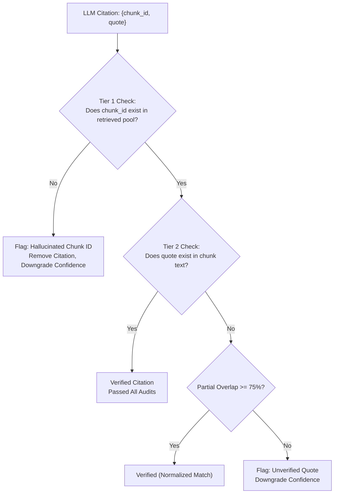
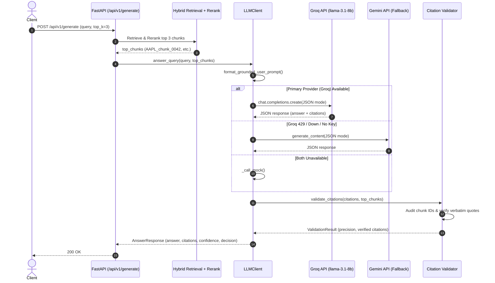

# Day 5 Learning Guide: Grounded LLM Generation & Citation Validation

Welcome to Day 5! Today we moved from retrieval into **generation**. We built a multi-provider LLM client with Groq (primary) and Google Gemini (fallback), engineered a strict grounded prompt template that enforces citation binding, and implemented a deterministic citation validator to eliminate hallucinations before responses ever reach the user.

---

## 1. Plain English Summary

Imagine an investment bank analyst tasked with answering executive questions from SEC filings:
1. **Unconstrained LLM (Open-Book / Pretrained)**: Like asking an analyst to answer from memory. They might remember that Apple makes hundreds of billions, but they could confuse FY2022 with FY2023 or guess an operating margin. In finance, this causes catastrophic compliance and trading errors.
2. **Grounded Generation (Closed-Book RAG)**: The analyst is handed three physical filing pages and told: *"You may ONLY answer using the exact numbers printed on these pages. For every statement, you must write down the page number and underline the exact sentence you got it from. If the pages don't mention the answer, write 'INSUFFICIENT EVIDENCE'."*
3. **Citation Validator**: An audit compliance officer who inspects the analyst's draft. They check:
   - Does the cited page actually exist in the packet?
   - Is the underlined sentence really on that page?
   If the analyst made up a page or misquoted a number, the auditor rejects or flags the claim.
4. **Provider Failover**: The primary analyst works on high-speed desk Groq. If that desk gets tied up by rate limits, the request immediately diverts to desk Gemini so the executive never waits.

---

## 2. First-Principles Concepts

### A. Parametric Memory vs. Grounded RAG Generation

LLMs store knowledge in their **parametric weights** (billions of floating-point numbers learned during pretraining).
- **Parametric failure modes in finance**:
  - **Temporal Staleness**: The model memorized 2021 data, but the user is asking about 2023 filings.
  - **Numeric Hallucination**: LLMs predict the *most statistically probable token sequence*, not arithmetic facts. `$383.3 billion` and `$393.3 billion` have nearly identical probability distributions.
  - **Attribution Confusion**: Blending Apple's gross margin with Microsoft's cloud growth.

By enforcing **Grounded Generation**, we instruct the transformer to suppress its internal parametric memory and act strictly as an **in-context information extraction and synthesis engine**.

```
Parametric Generation:
User Query ---> [ LLM Weights ] ---> Speculative Answer (High Hallucination Risk)

Grounded RAG Generation:
User Query + Retrieved Chunks ---> [ LLM In-Context Extractor ] ---> Grounded Answer + Citations
                                                                          |
                                                               [ Deterministic Validator ]
                                                                          |
                                                                   Audited Output
```

---

### B. Structured Citation Binding: JSON vs. Markdown Regex

Many naive RAG tutorials append `"[1]"` or `"[Chunk: AAPL_01]"` inside raw markdown prose and parse them with regular expressions. Why is that fragile?
1. **Regex Ambiguity**: The LLM might write `[Source: AAPL_01]`, `(Chunk 1)`, `[1]`, or `[AAPL_10-K_2023]`. Maintaining dozens of regex variations is brittle.
2. **Missing Quotes**: An inline citation tells you *which* chunk was cited, but doesn't tell you *what exact sentence* justified the claim.
3. **Structured API Contract**: Modern LLMs support JSON mode (`response_format={"type": "json_object"}`). By specifying an explicit JSON schema with `answer` and `citations: [{chunk_id, doc_id, quote}]`, the model is constrained by grammar-guided decoding to output valid, structured provenance.

---

### C. Two-Tier Citation Validation

A generated citation is not trustworthy until verified. Our validator runs two deterministic checks:



1. **Tier 1 (Chunk Existence)**:
   - Does `chunk_id` exist in the `retrieved_chunks` passed to the prompt?
   - If not, the model hallucinated an imaginary document ID.
2. **Tier 2 (Quote Verification)**:
   - Does `quote` appear as a substring inside the chunk's text?
   - We normalize whitespace and casing. If an exact substring match is absent, we calculate word-level lexical overlap ($>75\%$ threshold) to accommodate minor whitespace or formatting discrepancies.
   - If the quote does not exist, the model fabricated evidence.

---

### D. Active-Standby Failover & Error Discrimination

Why not just retry on every error?

```
Exception Occurs:
       |
       +---> RateLimitError (429) or 5xx Server Error?
       |        |
       |        v
       |     [ Tenacity Exponential Backoff ] (1s -> 2s -> 4s)
       |        |
       |        +---> Success? Continue.
       |        +---> 3 attempts exhausted? Switch to Gemini Fallback.
       |
       +---> AuthenticationError (401/403) or Invalid Key?
                |
                v
             [ Fast-Fail Policy ] (No Retries!)
                |
                v
             Immediately Switch to Gemini Fallback (0ms Wasted).
```

- **Transient Errors (429, 503)**: Caused by temporary RPM bursts. A 1–2 second backoff allows the token bucket to refill. Retrying makes sense.
- **Permanent Errors (401, 403, bad model name)**: An invalid API key will never succeed on retry. Retrying 3 times wastes 7 seconds of user latency for no reason. Fast-failing triggers instant fallback to the secondary provider in $<1$ millisecond.

---

## 3. Step-by-Step Request Walkthrough: `POST /api/v1/generate`

Let's trace:
```json
{
  "query": "What was Apple's total revenue in fiscal year 2023?",
  "top_k": 3
}
```



1. **Retrieval Stage**: Hybrid search retrieves candidates across dense and sparse indexes; cross-encoder reranks them to isolate the top 3 highest-quality chunks.
2. **Context Compilation**: Chunks are formatted into numbered blocks with document IDs, tickers, and section headers.
3. **Inference**: Primary LLM (Groq) is called in JSON mode. If Groq fails with 429, it retries with backoff; if credentials are invalid or exhausted, it immediately fails over to Gemini.
4. **Citation Audit**: Output citations are checked against input chunks. Valid citations pass; hallucinated chunk IDs or unverified quotes are caught and penalize the confidence score.
5. **Abstention Gate**: If the response contains `INSUFFICIENT_EVIDENCE` or `has_sufficient_evidence: false`, `decision` is marked `"abstain"` and `confidence` is set to `0.0`.
6. **Response**: Returns validated `AnswerResponse` with clean citations and latency metrics.

---

## 4. Interview Questions & Answers

### Q1: Why did we build a multi-provider fallback system rather than relying solely on Groq?
**Answer**:
Production RAG systems require high availability (99.9%+ uptime SLAs). On free tiers or even commercial tiers, LLM APIs are subject to rate limiting (429 Too Many Requests), capacity exhaustion, and cloud provider outages. By implementing an active-standby architecture using Groq (`llama-3.1-8b-instant`) as primary and Google Gemini (`gemini-1.5-flash`) as fallback, we achieve provider redundancy across two completely distinct cloud infrastructures at zero dollar cost. If Groq encounters rate limiting or downtime, traffic diverts automatically to Gemini without dropping the request or raising an error to the user.

### Q2: What is citation binding and why is it mandatory for financial RAG?
**Answer**:
Citation binding is the architectural requirement that every factual claim in an LLM's response must be explicitly tied to a verifiable chunk identifier and a supporting quote from the retrieved source document. In financial domains (SEC filings, earnings calls), ungrounded generation is a major compliance liability. Citation binding prevents "creative hallucination," enables human-in-the-loop auditability, and allows our system to programmatically verify that the LLM is synthesizing only what was retrieved rather than reciting memorized training data.

### Q3: How does our citation validator detect and handle hallucinations?
**Answer**:
Our citation validator implements a deterministic two-tier audit:
1. **Chunk ID Existence**: It verifies that the cited chunk ID is present in the candidate pool provided to the prompt. If the LLM invents a phantom ID (e.g., `chunk_999`), it is flagged as hallucinated.
2. **Verbatim Quote Verification**: It verifies that the cited quote text actually exists in the source chunk text using normalized substring matching and lexical overlap ($\ge 75\%$).
If a citation fails either check, it is removed from the verified citations list, and the response confidence score is proportionally degraded. If evidence is insufficient, the system abstains.

### Q4: Why do we separate transient error retries from permanent authentication errors?
**Answer**:
Transient errors (HTTP 429 rate limits, 502/503 network hiccups) are temporary states where exponential backoff with jitter allows token buckets to refill or servers to recover. In contrast, authentication errors (HTTP 401 Invalid Key, 403 Forbidden) are permanent configuration issues. Retrying an invalid key 3 times with exponential backoff introduces 7+ seconds of dead latency waiting for attempts that cannot succeed. Fast-failing permanent errors allows the client to trigger immediate provider failover in under 1 millisecond.

### Q5: Why did we set temperature to 0.0 for grounded financial Q&A?
**Answer**:
Temperature controls the entropy of the next-token probability distribution. In creative writing, temperature $>0.7$ encourages stylistic variety and unexpected phrasing. In financial document intelligence, variance is the enemy: we want deterministic greedy decoding that extracts numbers, dates, and regulatory disclosures with maximum factual fidelity. Temperature 0.0 minimizes hallucination, produces reproducible citations, and ensures identical prompt contexts generate identical answers.

### Q6: How does our prompt handle queries that cannot be answered from the retrieved context?
**Answer**:
The `GROUNDED_SYSTEM_PROMPT` explicitly instructs the model: *"If the provided chunks do NOT contain enough information to answer the question, state: 'INSUFFICIENT_EVIDENCE' and set 'has_sufficient_evidence': false."* When this occurs, our `LLMClient` marks `decision = "abstain"` and sets `confidence = 0.0`. In financial applications, an explicit "I don't know" is dramatically more valuable than a plausible-sounding fabrication.

### Q7: Why do we format retrieved chunks with metadata (ticker, doc_type, section) in the prompt?
**Answer**:
Financial documents have distinct regulatory authority and structure. A statement in a 10-K (Item 1A Risk Factors) has different legal weight than an unscripted executive comment during an earnings call Q&A. Providing `doc_type` ("10-K" vs "earnings_call") and `section` ("Item 7 MD&A") provides critical semantic framing that helps the LLM distinguish historical audited results from forward-looking executive commentary.

### Q8: What is the difference between open-book QA and closed-book QA in RAG?
**Answer**:
In **open-book QA**, the LLM is encouraged to blend retrieved context with its own internal pretrained knowledge base. In **closed-book RAG**, the model is strictly constrained to treat the retrieved context as the *complete and exclusive universe of facts*. Closed-book RAG is essential in enterprise financial workflows because pretraining data may be outdated, biased, or inconsistent with the exact quarterly filing being audited.

---

## 5. Self-Check Questions

1. **True or False**: An LLM set to temperature 0.0 will never hallucinate a fact.  
   *(Answer: False. Temperature 0.0 chooses the highest probability token at each step, but if the prompt is ungrounded or ambiguous, the highest probability token can still be a hallucination. Grounded prompts + citation validation are required to prevent and catch hallucinations.)*

2. **What HTTP status code represents a rate limit on Groq or Gemini?**  
   *(Answer: HTTP 429 Too Many Requests.)*

3. **If a citation specifies chunk `AAPL_01` but the quote cannot be found in `AAPL_01`'s text, which check failed?**  
   *(Answer: Tier 2 Quote Verification failed.)*

4. **Why do we clean markdown fences (` ```json `) before parsing the LLM response?**  
   *(Answer: Even in JSON mode, some LLMs wrap their response in markdown code blocks, which causes standard `json.loads()` to raise a JSONDecodeError.)*

5. **What decision is assigned in `AnswerResponse` if the model outputs `INSUFFICIENT_EVIDENCE`?**  
   *(Answer: `decision = "abstain"` with `confidence = 0.0`.)*

---

## 6. Failure Modes & Edge Cases

| Failure Mode | Root Cause | Impact | Mitigation in Engine |
|---|---|---|---|
| **Rate Limit Cascade** | High traffic burst exhausts Groq's 30 RPM quota. | Subsequent queries fail if single-provider. | Automatic fallback to Gemini (15 RPM) + exponential backoff retry. |
| **Phantom Chunk Citations** | Model outputs a plausible chunk ID (e.g. `AAPL_10-K_2023_chunk_0099`) not in context. | Misleads user into believing fact is verified. | Citation validator Tier 1 checks existence against retrieved pool and removes invalid citations. |
| **Quote Paraphrasing** | Model paraphrases source text instead of quoting verbatim. | Fails exact string match. | Two-step matching: normalized exact substring followed by $\ge 75\%$ lexical word overlap. |
| **JSON Formatting Errors** | Model emits trailing commas or invalid escaping. | `json.loads` fails. | Robust sanitization (`_clean_json_text`) + regex recovery fallback. |

---

## 7. Recommended Reading

1. **Lewis et al. (2020)**: *"Retrieval-Augmented Generation for Knowledge-Intensive NLP Tasks"* — The foundational paper on RAG architectures.
2. **Gao et al. (2023)**: *"Enabling Large Language Models to Generate Text with Citations"* — Analysis of citation binding techniques and citation recall/precision metrics.
3. **Google DeepMind (2024)**: *"Gemini: A Family of Highly Capable Multimodal Models"* — Technical report covering JSON mode and system instruction steerability.
4. **Groq Architecture Whitepaper (2024)**: *"Language Processing Units (LPUs) for Real-Time Inference"* — Hardware architecture underlying sub-500ms token generation.
