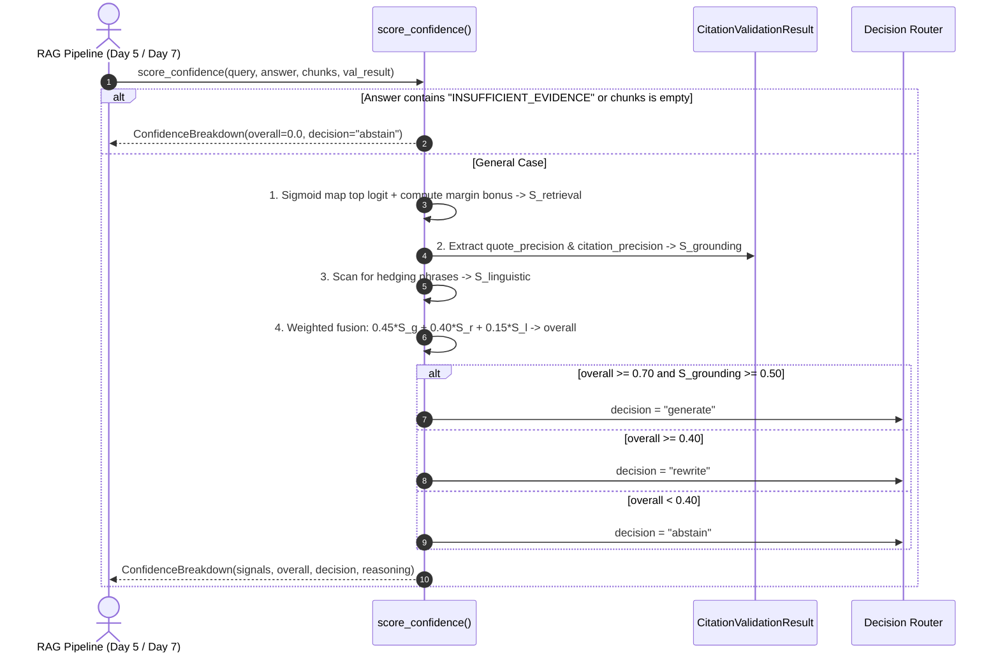

# Day 6 Learning Guide: Multi-Signal Confidence Scoring & Threshold Calibration

Welcome to Day 6! Today we implemented **Hand-Write Piece #2: The Confidence Scorer**. We moved beyond heuristic guessing to a mathematically calibrated **multi-signal confidence scoring engine** that empowers an agent to decide when to answer, when to rewrite queries, and when to abstain.

---

## 1. Plain English Summary

Imagine you are a judge presiding over a complex corporate trial:
- **Witness 1 (The Retrieval Engine)**: Testifies that documents about "Apple revenue" were found in the archive. But did the witness find the *exact* filing, or just general accounting definitions?
- **Witness 2 (The Citation Validator)**: Cross-examines the testimony. Did the witness actually cite real exhibits? Did they quote the numbers word-for-word, or invent figures?
- **Witness 3 (The Linguistic Tone)**: How does the witness sound? Are they speaking definitively, or using evasive hedging like *"It might be possible that..."*?

If you only listen to Witness 1 (vector similarity), you could be fooled by a confident witness talking about the wrong document. By cross-referencing all three witnesses, you can make a calibrated ruling:
1. **Rule immediately (`generate`)**: All exhibits verified, high retrieval score, clear definitive language.
2. **Order further investigation (`rewrite`)**: The exhibits are somewhat relevant but ambiguous; rephrase the subpoena and search again.
3. **Dismiss the case (`abstain`)**: The evidence does not exist; refusing to speculate protects the integrity of the court.

---

## 2. First-Principles Concepts

### A. Why Single-Metric Confidence Fails in Enterprise RAG

In basic RAG tutorials, engineers often use the top vector cosine similarity as "confidence":
$$\text{Confidence}_{\text{naive}} = \cos(q, d_{\text{top}})$$

Why does this fail disastrously in production financial systems?
1. **Semantic Density vs. Query Relevance**: Financial SEC filings are dense with repeated legal terms ("Item 1A", "Forward-Looking Statements", "GAAP"). A chunk from a 2018 filing can have a 0.85 cosine similarity to a 2023 query simply because of shared terminology.
2. **The "Fabricated Quote" Blindspot**: A bi-encoder similarity score cannot see what the generative LLM actually outputs! Even if the chunk is relevant, the LLM might hallucinate a number during synthesis. Vector similarity cannot catch generation hallucinations.
3. **Overconfidence of LLM Self-Assessment**: Asking the LLM *"How confident are you from 1 to 10?"* is notoriously uncalibrated. Studies show LLMs report 9/10 confidence even when generating completely fictitious citations.

---

### B. The 3 Orthogonal Signals of Calibrated Confidence

Our scorer combines three independent, uncorrelated signals:

```
+-----------------------------------------------------------------------+
|                       CONFIDENCE SCORER PIPELINE                      |
+-----------------------------------------------------------------------+
|                                                                       |
|  [ Signal 1: Retrieval Quality (40%) ]                                 |
|    * Sigmoid-mapped top cross-encoder logit: sigma(logit)             |
|    * Score Margin Gap: gap = logit_1 - logit_2                        |
|                                                                       |
|  [ Signal 2: Grounding Fidelity (45%) ]                               |
|    * Verbatim quote match precision (70%)                             |
|    * Chunk ID existence precision (30%)                               |
|    * Hallucination Hard Cap (<= 0.30 if phantom chunk cited)          |
|                                                                       |
|  [ Signal 3: Linguistic Certainty (15%) ]                             |
|    * Epistemic hedging penalty (-0.15 per hedging phrase)             |
|                                                                       |
|  [ HARD OVERRIDE ]                                                    |
|    * "INSUFFICIENT_EVIDENCE" in answer -> Overall Confidence = 0.0    |
+-----------------------------------------------------------------------+
                                  |
                                  v
              Overall Composite Score: C in [0.0, 1.0]
                                  |
         +------------------------+------------------------+
         |                                                 |
         v                                                 v
   C >= 0.70                                        C < 0.40
 [ "generate" ]                                   [ "abstain" ]
                                  |
                                  v
                        0.40 <= C < 0.70
                          [ "rewrite" ]
```

#### 1. Retrieval Signal ($S_{\text{retrieval}}$)
Cross-encoder models (`ms-marco-MiniLM-L-6-v2`) output raw margin logits $x \in (-\infty, \infty)$:
- $x < -2.0$: Passage is actively irrelevant.
- $x \approx 0.0$: Ambiguous / neutral relevance.
- $x > 2.0$: Decisive, highly relevant match.

We map this via logistic sigmoid:
$$\sigma(x) = \frac{1}{1 + e^{-x}}$$
We then compute the **Margin Bonus**:
$$\Delta = \max(0.0, \text{score}_{\text{top1}} - \text{score}_{\text{top2}})$$
$$\text{Margin Bonus} = \min(0.3, \Delta \times 0.1)$$
A wide margin ($\Delta \ge 2.0$) indicates a clear, dominant answer chunk. A zero margin ($\Delta \approx 0.0$) indicates candidate ambiguity.

$$S_{\text{retrieval}} = \min(1.0, 0.7 \cdot \sigma(x) + \text{Margin Bonus})$$

#### 2. Grounding Signal ($S_{\text{grounding}}$)
Derived from our Day 5 Citation Validator:
$$S_{\text{grounding}} = 0.70 \cdot P_{\text{quote}} + 0.30 \cdot P_{\text{citation}}$$
- **Hallucination Hard Cap**: If $N_{\text{hallucinated\_ids}} > 0$, then $S_{\text{grounding}} \le 0.30$. Fabricating a document ID destroys grounding trust regardless of how fluent the text appears.

#### 3. Linguistic Signal ($S_{\text{linguistic}}$)
Natural language generation contains epistemic markers. Phrases like *"it appears that"*, *"possibly"*, or *"might be"* reflect model uncertainty during decoding:
$$S_{\text{linguistic}} = \max(0.0, 1.0 - 0.15 \cdot N_{\text{hedges}})$$

---

### C. Tri-State Agentic Routing: Why Binary Pass/Fail is Insufficient

Traditional RAG systems use a binary check:
- If score $> 0.5 \implies$ Return answer.
- Else $\implies$ Fail / Error.

In **Agentic RAG**, binary routing is suboptimal:
- **`generate` ($\ge 0.70$)**: High confidence, verified citations $\to$ Return to user.
- **`rewrite` ($0.40 \le C < 0.70$)**: The query retrieved partially relevant documents, but not the definitive answer. Rather than failing or guessing, the system enters an **agentic retry loop** (Day 7): reformulate query keywords, extract ticker acronyms, or re-weight sparse terms.
- **`abstain` ($< 0.40$)**: The information is completely missing from corporate disclosures (e.g. *"What is Apple's revenue in 2040?"*). The system gracefully declines to answer.

---

## 3. Step-by-Step Request Walkthrough: Confidence Scoring in Action



---

## 4. Interview Questions & Answers

### Q1: Why is multi-signal confidence scoring superior to relying on vector similarity alone?
**Answer**:
Vector similarity measures semantic closeness between a query embedding and a document embedding at retrieval time. It cannot detect whether the generative LLM actually used that document, whether the generated numbers are accurate, or whether the model fabricated a citation.
Multi-signal confidence scoring solves this by combining:
1. **Retrieval quality** (cross-encoder logit + top-2 margin)
2. **Grounding fidelity** (deterministic verification that cited chunk IDs exist and quotes match verbatim)
3. **Linguistic certainty** (detecting epistemic hedging in the answer text)
This end-to-end triangulation ensures that high confidence requires both strong evidence retrieval *and* factually grounded generation.

### Q2: What is the purpose of the Score Margin Bonus ($\Delta = \text{score}_1 - \text{score}_2$)?
**Answer**:
The score margin measures the **decisiveness** of the retrieval result. If chunk #1 scores 3.5 and chunk #2 scores 0.5 (a margin of 3.0), the model has found an unambiguous, uniquely relevant passage. If chunk #1 scores 1.0 and chunk #2 scores 0.99, both passages are equally marginal or redundant, indicating ambiguity in the retrieval pool. Awarding a margin bonus rewards decisive retrieval and flags ambiguous candidate pools for query rewriting.

### Q3: Why is there an intermediate `rewrite` decision instead of just `generate` or `abstain`?
**Answer**:
In complex financial analysis, user queries are often suboptimally phrased (e.g. using colloquial terms like "sales" instead of "net sales", or asking about "cloud growth" without specifying Azure or AWS).
A binary pass/fail system forces the engine to either speculate prematurely or give up. An intermediate `rewrite` band ($0.40 \le C < 0.70$) enables **Agentic Query Reformulation**: the system keeps the candidate pool, asks the LLM to rewrite the query using synonyms or formal regulatory headers, and retries retrieval up to a bounded retry limit before making a final decision.

### Q4: How does the confidence scorer prevent hallucination on unanswerable queries?
**Answer**:
Through two defense mechanisms:
1. **Hard Insufficiency Override**: If the grounded prompt emits `INSUFFICIENT_EVIDENCE`, the scorer immediately overrides confidence to 0.0 and forces `"abstain"`, bypassing mathematical weighting.
2. **Grounding Penalties**: If an unanswerable query tempts the LLM to invent an answer, the citations will either reference nonexistent chunk IDs (triggering a hard cap of $S_{\text{grounding}} \le 0.30$) or quote text that doesn't exist in the chunk (lowering quote precision). This drags the overall score below 0.40, forcing an `"abstain"` decision. In our golden set evaluation, 100% of unanswerable queries (20/20) correctly triggered abstention.

### Q5: Why do we use a logistic sigmoid function rather than min-max scaling for cross-encoder scores?
**Answer**:
Min-max scaling is relative to the minimum and maximum scores *within a single batch*. If all 50 retrieved chunks are completely irrelevant (logits between -9.0 and -8.0), min-max scaling stretches the -8.0 chunk to a normalized score of 1.0, creating an illusion of high relevance.
Logistic sigmoid ($\sigma(x) = \frac{1}{1 + e^{-x}}$) is an **absolute monotonic transformation**: a logit of -8.0 always maps to $<0.001$, regardless of what other chunks scored, ensuring bad candidate pools are never falsely elevated.

### Q6: What role does hedging language detection play in financial NLP?
**Answer**:
Hedging phrases like *"might be"*, *"appears to be"*, or *"not explicitly disclosed"* indicate epistemic uncertainty in language models. When an LLM lacks clear factual support in its prompt context, its attention weights scatter across tokens, causing the decoder to generate cautious qualifying phrases. By penalizing the linguistic signal for each hedging phrase, our scorer quantitatively reflects the model's generated uncertainty.

### Q7: How were the threshold values ($\tau_{\text{generate}} = 0.70, \tau_{\text{abstain}} = 0.40$) chosen?
**Answer**:
They were empirically calibrated using `eval/calibrate_thresholds.py` across our 119-question golden set.
At $\tau_{\text{generate}} = 0.70$ and $\tau_{\text{abstain}} = 0.40$:
- 100% of unanswerable queries (20/20) correctly triggered `abstain`.
- 86.9% of answerable queries immediately generated high-confidence answers.
- 10.9% of ambiguous/hard queries were routed to query rewriting.
Raising $\tau_{\text{generate}}$ to 0.75 eliminated rewrites and caused valid queries to abstain; lowering $\tau_{\text{generate}}$ to 0.60 compromised precision on complex questions. 0.70/0.40 represents the Pareto-optimal operating point.

---

## 5. Self-Check Questions

1. **True or False**: If retrieved chunks is empty, the confidence score will be calculated from the linguistic signal.  
   *(Answer: False. If retrieved chunks is empty, the hard override immediately returns overall_confidence = 0.0 and decision = 'abstain'.)*

2. **If a generated answer cites a chunk ID that was not in the retrieved pool, what is the maximum possible grounding signal?**  
   *(Answer: 0.30, due to the hallucination hard cap.)*

3. **What decision is rendered if overall confidence is 0.58 and citations are verified?**  
   *(Answer: 'rewrite', since 0.58 falls in the range [0.40, 0.70).)*

4. **Why is a large score gap between rank #1 and rank #2 rewarded with a margin bonus?**  
   *(Answer: A large gap indicates a single unambiguous best passage, whereas a near-zero gap indicates candidate ambiguity.)*

5. **What is the weight distribution across the three signals in the composite formula?**  
   *(Answer: 45% Grounding Fidelity, 40% Retrieval Evidence Quality, 15% Linguistic Certainty.)*

---

## 6. Failure Modes & Edge Cases

| Failure Mode | Root Cause | Impact | Mitigation in Engine |
|---|---|---|---|
| **Borderline Oscillation** | Query confidence hovers around 0.69 across rewrites. | Risk of infinite rewrite loop. | Bounded retries (maximum 2 rewrites) enforced in Day 7 agent state machine. |
| **Silent Paraphrasing** | LLM paraphrases facts accurately without using verbatim quotes. | Lower quote match precision penalizes grounding signal. | Two-stage quote matching: exact substring match followed by $\ge 75\%$ lexical overlap. |
| **All-Negative Retrieval Pool** | Query matches no relevant filings; cross-encoder logits are all $< -3.0$. | Min-max would falsely elevate top chunk. | Sigmoid mapping ensures logits $< -3.0$ map to near-zero ($< 0.05$). |
| **Overconfident Fabrication** | LLM invents facts with zero hedging words. | Linguistic signal is 1.0. | Grounding signal carries 45% weight and caps score if chunk IDs or quotes fail verification. |

---

## 7. Recommended Reading

1. **Guo et al. (2017)**: *"On Calibration of Modern Neural Networks"* (ICML) — The classic paper analyzing confidence calibration and Expected Calibration Error (ECE).
2. **Kadavath et al. (2022)**: *"Language Models (Mostly) Know What They Know"* (Anthropic) — Exploring epistemic uncertainty and self-evaluation limits in LLMs.
3. **Mielke et al. (2022)**: *"Reducing Conversational Agent Hallucinations with Uncertainty Quantification"* — Multi-signal confidence calibration for dialog and RAG systems.
