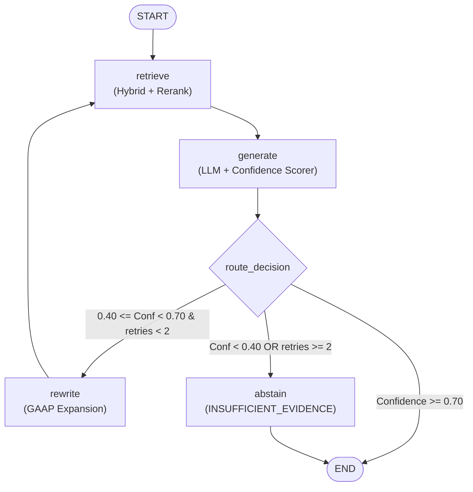

# Day 7 Learning Guide: LangGraph StateGraph, Cyclical Agentic Loops & Query Rewriting

Welcome to Day 7! Today we implemented **Hand-Write Piece #3: The LangGraph StateGraph Agent Definition**. We evolved our architecture from a linear retrieval-generation pipeline into a true **autonomous, cyclical agentic system** capable of evaluating its own confidence, rewriting queries when evidence is ambiguous, and enforcing disciplined abstention when evidence is absent.

---

## 1. Plain English Summary

Imagine you are a senior equity research analyst at an investment bank:
- An associate asks you: *"How much money did Apple make last year?"*
- You search the SEC EDGAR filing archive for `"how much money did Apple make last year"`.
- The search engine returns generic boilerplate filings about cash flow policies. The evidence is ambiguous—you cannot state the exact revenue with 100% certainty.
- **In a naive linear system (RAG 1.0)**: The system shrugs, guesses an answer anyway, or quotes an unrelated cash flow line, producing a dangerous hallucination.
- **In an agentic loop (RAG 2.0)**: You realize the query was poorly formulated. You translate colloquial terms into GAAP language: `"AAPL Apple Inc. Form 10-K fiscal year 2023 Total Net Sales Item 7 MD&A"`.
- You run a second retrieval pass with this optimized query.
- Now, you hit Note 10 and the Consolidated Statements of Operations directly. With overwhelming evidence and high confidence, you produce a verified, cited answer.

If, after your retry budget is exhausted, the information genuinely does not exist (e.g., *"What is Apple's projected revenue in 2075?"*), you do not hallucinate. You issue a disciplined abstention notice: *"INSUFFICIENT_EVIDENCE: The documents do not contain forecasts for 2075."*

---

## 2. First-Principles Concepts

### A. Linear DAGs vs. Cyclical State Machines

Traditional LangChain pipelines (`Chain`, `LCEL`) are strictly **Directed Acyclic Graphs (DAGs)**:

$$\text{Input} \longrightarrow \text{Retrieve} \longrightarrow \text{Prompt} \longrightarrow \text{LLM} \longrightarrow \text{Output}$$

Why is a DAG insufficient for high-stakes enterprise information retrieval?
1. **Single-Shot Vulnerability**: In a linear DAG, if retrieval fails on step 1, the failure propagates irreversibly down the entire pipeline. The LLM is forced to either hallucinate or fail.
2. **No Self-Correction**: Real research requires iterative exploration: search $\to$ evaluate $\to$ reformulate $\to$ re-search.
3. **No Dynamic Branching**: A DAG cannot dynamically decide whether to answer, loop, or abort based on run-time telemetry without cumbersome nested conditionals.

**LangGraph `StateGraph`** replaces linear chains with a state-machine architecture that natively supports cycles:



---

### B. The Core Properties of `StateGraph`

1. **State as the Single Source of Truth**:
   The graph operates over a shared `AgentState`. Each node receives the current state and returns a dictionary of keys to update:
   ```python
   class AgentState(TypedDict, total=False):
       query: str
       current_query: str
       retrieved_chunks: List[SearchResult]
       answer: str
       citations: List[Citation]
       confidence: float
       decision: str
       retry_count: int
       max_retries: int
       rewrite_history: List[str]
   ```
   LangGraph merges each node's output into the global state automatically, preventing state mutation races.

2. **Conditional Edges**:
   Instead of hardcoding the next node, conditional edges inspect the state at runtime:
   ```python
   builder.add_conditional_edges(
       "generate",
       route_decision,
       {"generate": END, "rewrite": "rewrite", "abstain": "abstain"}
   )
   ```

3. **Guaranteed Halting with Retry Budgets**:
   Any cyclical graph risks infinite loops:
   $$\text{Retrieve} \longleftrightarrow \text{Rewrite} \quad (\text{Infinite Cycle})$$
   To guarantee termination, the conditional router inspects `retry_count < max_retries`. If the retry budget is exhausted, the router forces a transition to `abstain`, guaranteeing termination in at most $O(N)$ cycles.

---

### C. Financial Query Reformulation Strategy

SEC filings adhere to standardized accounting rules (US GAAP / IFRS) and strict regulatory disclosure headers. Colloquial user questions fail because the vector embeddings and BM25 keywords mismatch the legal document text.

Our query rewriter applies a multi-stage deterministic expansion:

| User Query | Problem | Rewriter Transformation |
|---|---|---|
| `"how much debt does Apple have?"` | Colloquial terms `"how much"`, `"debt"` | `AAPL Apple total debt liabilities commercial paper term notes credit facility` |
| `"tell me about iPhone sales"` | Conversational filler, informal metric | `AAPL iPhone net sales total revenue consolidated operations` |
| `"what are the risk factors?"` | Ambiguous generic term | `Item 1A risk factors operational risks uncertainties` |

#### Progressive Deepening on Retries
If the first rewrite still yields ambiguous confidence, the agent deepens the search vocabulary:
- **Iteration 1**: Appends regulatory headers: `"Item 7 Management Discussion Analysis Item 8 Financial Statements"`.
- **Iteration 2**: Appends accounting statement headers: `"Consolidated Statements of Operations Balance Sheets Cash Flows Notes"`.

---

## 3. Code Walkthrough: Hand-Write Piece #3

Here is how our `build_agent_graph()` in [`app/agent/graph.py`](file:///Users/akashg/Desktop/Financial-Document-Agentic-RAG-Engine/app/agent/graph.py) constructs the state machine:

```python
from langgraph.graph import StateGraph, START, END

def build_agent_graph():
    # 1. Initialize StateGraph with our typed state
    builder = StateGraph(AgentState)

    # 2. Register all workflow nodes
    builder.add_node("retrieve", retrieve_node)
    builder.add_node("generate", generate_node)
    builder.add_node("rewrite", rewrite_node)
    builder.add_node("abstain", abstain_node)

    # 3. Connect entry point and sequential edges
    builder.add_edge(START, "retrieve")
    builder.add_edge("retrieve", "generate")

    # 4. Attach conditional routing logic from generate
    builder.add_conditional_edges(
        "generate",
        route_decision,
        {
            "generate": END,
            "rewrite": "rewrite",
            "abstain": "abstain",
        },
    )

    # 5. Connect rewrite loop back to retrieve (the agentic cycle)
    builder.add_edge("rewrite", "retrieve")

    # 6. Connect terminal abstain node to END
    builder.add_edge("abstain", END)

    # 7. Compile state graph into runnable application
    return builder.compile()
```

### The Conditional Routing Function:

```python
def route_decision(state: AgentState) -> str:
    decision = state.get("decision", "abstain")
    retries = state.get("retry_count", 0)
    max_retries = state.get("max_retries", 2)

    if decision == "generate":
        return "generate"
    elif decision == "rewrite":
        if retries < max_retries:
            return "rewrite"
        else:
            return "abstain"  # Budget exhausted!
    else:
        return "abstain"
```

---

## 4. Production Edge Cases & Mitigations

| Failure Mode | Production Impact | Mitigation in Engine |
|---|---|---|
| **Infinite Rewrite Loop** | Runaway LLM API calls and cost explosion | Hard retry budget check (`max_retries=2`) in `route_decision` immediately diverts to `abstain`. |
| **Empty Retrieval on Query Rewrite** | Crash when LLM attempts to generate from `[]` chunks | `generate_node` detects empty chunks; immediately overrides confidence to `0.0` and signals `abstain`. |
| **Circular Query Oscillations** | Rewriter generates query $A \to B \to A$ | `rewrite_history` logs all prior queries; rewriter applies progressive deepening on each iteration. |
| **Latency Creep from Retries** | Multiple retrieval passes take $> 3$ seconds | Day 8 introduces **Semantic Caching** to instantly serve previously resolved queries from Redis in $< 5$ ms. |

---

## 5. Academic Foundations & Further Reading

1. **Yan et al. (2024)**: *"Corrective Retrieval Augmented Generation (CRAG)"* — Formalized evaluating retrieval confidence and triggering autonomous query rewriting or web search when confidence is ambiguous.
2. **Asai et al. (2023)**: *"Self-RAG: Learning to Retrieve, Generate, and Critique through Self-Reflection"* — Demonstrated the power of critique tokens and confidence gating to eliminate hallucinations.
3. **LangChain / LangGraph Team (2024)**: *"LangGraph Architecture & Multi-Agent Design Patterns"* — Why stateful cyclic graphs outperform linear chains for production LLM systems.
